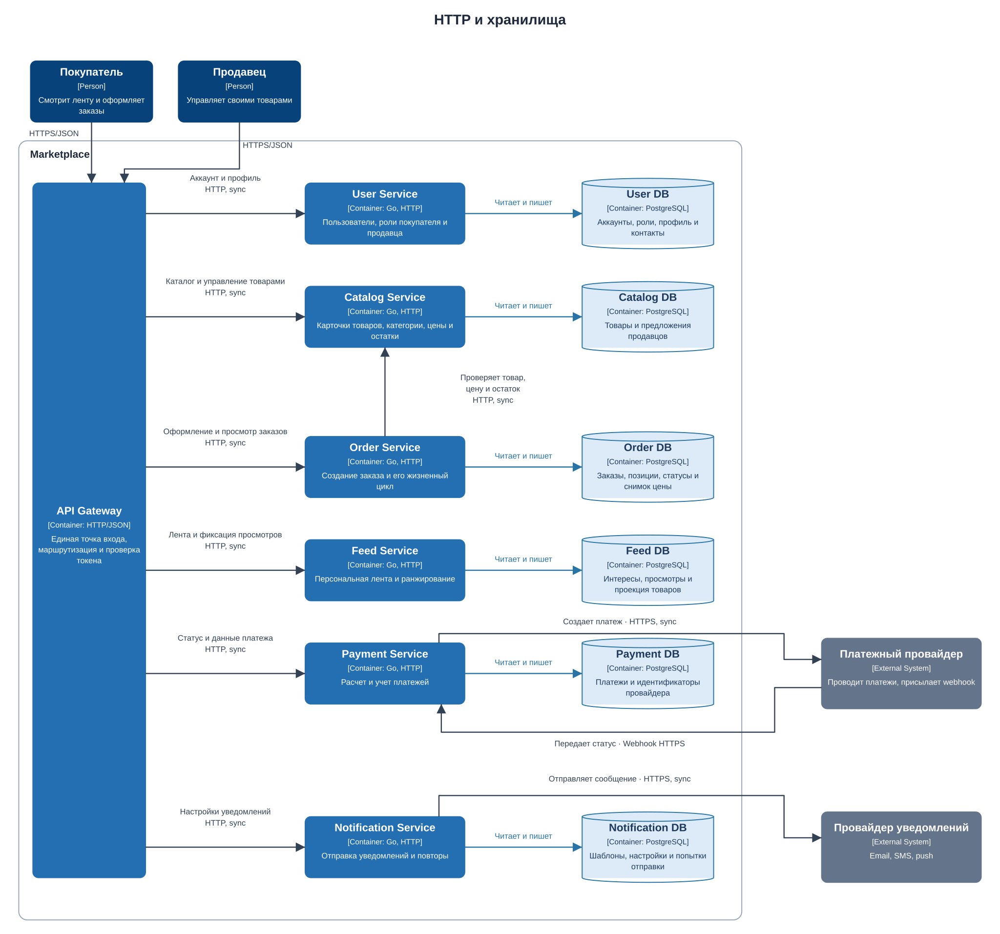
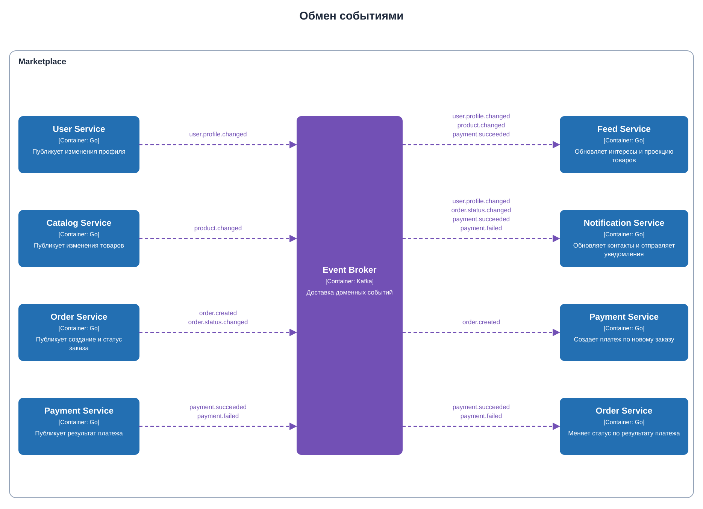

# Marketplace architecture

Первое домашнее задание по курсу СОА.

## C4 Container

Так как на одной диаграмме было куча наложений, было принято решение разделить диаграммы на 2 - на одной изобразить взаимодействия сервисов по HTTP и с хранилищами, а на другой изобразить взаимодействия через брокера

### Сервисы и БДшки



Исходник диаграммы: [`docs/c4-container.puml`](docs/c4-container.puml).

### Обмен событиями



Исходник: [`docs/c4-events.puml`](docs/c4-events.puml).

## Персонализация ленты

Я выбрал простую формулу. Для нее `Feed Service` считает интерес пользователя по категориям и брендам, которые он смотрел или покупал.

Сама формула:

```text
score = 0.55 * interest + 0.30 * popularity + 0.15 * freshness
```

Для нового пользователя используются только популярность и свежесть.

## Домены и ответственность

| Домен | Ответственность |
|---|---|
| Users | Регистрация, вход, профиль, контакты, роли покупателя и продавца |
| Catalog | Карточки товаров, категории, цены, остатки, принадлежность товара продавцу |
| Feed | Сбор просмотров, интересы пользователя, ранжирование и выдача ленты |
| Orders | Создание заказа, позиции заказа, снимок цены, статусы и история изменений |
| Payments | Создание и учет платежа, сумма, статус, связь с транзакцией провайдера |
| Notifications | Шаблоны, настройки каналов, отправка и повторные попытки |

## Распределение доменов по сервисам

Основные домены выделены в отдельные сервисы.

| Сервис | Домен | Почему отдельно |
|---|---|---|
| User Service | Users | Одна модель пользователя для покупателя и продавца, поэтому два отдельных сервиса тут не нужны |
| Catalog Service | Catalog | Товары часто читаются и независимо меняются продавцами |
| Feed Service | Feed | У ленты отдельная нагрузка и алгоритм ранжирования будет меняться чаще остальной системы |
| Order Service | Orders | У заказа свой жизненный цикл и требования к сохранению истории |
| Payment Service | Payments | Платежные данные чувствительные |
| Notification Service | Notifications | Отправка уведомлений асинхронная, может падать и повторяться независимо от заказа |

## Владение данными

| Сервис | Владеет данными | Чужие данные внутри сервиса |
|---|---|---|
| User Service | Аккаунт, хеш пароля, роли, профиль, контакты | Нет |
| Catalog Service | Товар, категория, цена, остаток, `seller_id` | `seller_id` хранится только как ссылка на владельца из User Service |
| Feed Service | Просмотры, веса интересов, сохраненная проекция товаров, рассчитанный score | Копия части товара является проекцией, не источником истины |
| Order Service | Заказ, позиции, статус, история, снимок названия и цены | `user_id` и `product_id` являются ссылками, цена копируется как исторический снимок |
| Payment Service | Платеж, сумма, валюта, статус, id транзакции провайдера | Карточные данные не сохраняются |
| Notification Service | Шаблоны, настройки каналов, задачи отправки, попытки и результат | Контакт пользователя обновляется из события User Service |

Общих таблиц и общей базы между сервисами нет. Сервис может получить данные только через API или событие.

## Взаимодействия

### Синхронные

| Откуда | Куда | Для чего |
|---|---|---|
| Клиент | API Gateway | Все пользовательские запросы по HTTPS/JSON |
| API Gateway | User, Catalog, Feed, Order, Payment, Notification | Маршрутизация запросов к нужному сервису |
| Order Service | Catalog Service | Проверка товара, текущей цены и остатка перед созданием заказа |
| Payment Service | Платежный провайдер | Создание платежа и запрос его состояния |
| Платежный провайдер | Payment Service | Webhook с итоговым статусом |
| Notification Service | Провайдер уведомлений | Отправка email, SMS или push |

Синхронный вызов используется там, где ответ нужен сразу. Например, заказ нельзя принять с несуществующим товаром.

### Асинхронные

| Событие | Производитель | Потребители |
|---|---|---|
| `user.profile.changed` | User Service | Feed Service, Notification Service |
| `product.changed` | Catalog Service | Feed Service |
| `order.created` | Order Service | Payment Service |
| `payment.succeeded` / `payment.failed` | Payment Service | Order Service, Feed Service, Notification Service |
| `order.status.changed` | Order Service | Notification Service |

Асинхронность нужна для побочных действий и распространения фактов. Заказ и платеж некоторое время могут находиться в промежуточных статусах, то есть между ними используется eventual consistency. Обработчики событий должны быть идемпотентными, потому что событие может прийти повторно.

## Пример оформления заказа

1. Покупатель отправляет запрос через `API Gateway` в `Order Service`.
2. `Order Service` синхронно проверяет товар и цену в `Catalog Service`.
3. Заказ сохраняется со статусом `pending_payment`, после чего публикуется `order.created`.
4. `Payment Service` создает платеж у провайдера.
5. После webhook сервис публикует `payment.succeeded` или `payment.failed`.
6. `Order Service` меняет статус заказа и публикует `order.status.changed`.
7. `Notification Service` отправляет уведомление покупателю.

## Архитектурные решения

### Границы по бизнес-ответственности

Сервисы выделены по бизнес-областям. Это дает более высокий cohesion внутри сервиса и уменьшает количество причин менять несколько сервисов одновременно.

### У каждого сервиса своя БД

У каждого сервиса собственная база и только он может в нее писать. Это позволяет независимо менять схему и не превращать набор сервисов в распределенный монолит.

### Смешанные интеграции

HTTP используется для запросов, где нужен результат сразу. События используются для уведомлений, платежного процесса и обновления ленты.

### Изоляция платежей

`Payment Service` отделен от заказов и пользователей. В нем находятся только данные учета платежа и идентификаторы внешнего провайдера. Номера карт в систему не попадают.

## Варианты декомпозиции и trade-off'ы

### Вариант 1. Модульный монолит

Один Go-процесс с модулями Users, Catalog, Feed, Orders, Payments и Notifications. Одна PostgreSQL, но таблицы разделены по схемам.

Плюсы:

- проще запустить, тестировать и отлаживать;
- обычные ACID-транзакции;
- нет сетевых ошибок между модулями;
- меньше инфраструктуры и дешевле поддержка.

Минусы:

- все модули выпускаются вместе;
- ленту нельзя масштабировать отдельно от оформления заказа;
- ошибка или тяжелый запрос в одном модуле влияет на весь процесс;
- платежный контур хуже изолирован.

### Вариант 2. Три крупных сервиса

- `Core Service`: пользователи и каталог;
- `Commerce Service`: заказы и платежи;
- `Engagement Service`: лента и уведомления.

Плюсы:

- сервисов и сетевых вызовов меньше
- уже есть независимое развертывание крупных частей
- эксплуатация проще, чем у полной доменной декомпозиции

Минусы:

- платежи связаны с заказами одним релизом и одной базой
- каталог связан с пользователями, хотя меняются они по разным причинам
- лента и уведомления слабо связаны по бизнес-смыслу
- при росте придется повторно делить сервисы и переносить данные

### Вариант 3. Доменные сервисы

Это вариант на C4-диаграмме: User, Catalog, Feed, Order, Payment и Notification Service.

Плюсы:

- независимое развертывание и масштабирование
- понятное владение данными
- отдельный платежный контур
- сбой отправки уведомления не ломает оформление заказа
- ленту можно развивать и масштабировать независимо

Минусы:

- больше инфраструктуры
- появляются сетевые задержки и частичные отказы
- нужна совместимость контрактов
- заказ и платеж согласуются не мгновенно
- сложнее локальная разработка, мониторинг и трассировка

## Финальный выбор

Я выбрал вариант 3. В требованиях есть области с разной нагрузкой и скоростью изменений: лента много читается и часто меняет алгоритм, каталог независимо обновляется продавцами, заказы требуют истории, платежи содержат чувствительные данные, уведомления являются асинхронным побочным действием.

Как я понимаю, это модульный монолит. В рамках этого кейса выбран набор доменных сервисов, он лучше показывает границы владения данными и позволяет независимо развивать основные части маркетплейса.

## Запуск через Docker Compose

```bash
docker compose up --build
```

Проверка:

```bash
curl -i http://localhost:8080/health
```

Ожидаемый ответ:

```text
HTTP/1.1 200 OK
Content-Type: application/json

{"status":"ok"}
```

Остановка:

```bash
docker compose down
```

## Локальный запуск

Требуется Go 1.23+.

```bash
go run ./cmd/catalog
```

В другом терминале:

```bash
curl -i http://localhost:8080/health
```

Тесты:

```bash
go test ./...
```

## Структура проекта

```text
.
├── cmd/catalog/main.go
├── cmd/catalog/main_test.go
├── docs/c4-container.puml
├── docs/c4-container.svg
├── docs/c4-events.puml
├── docs/c4-events.svg
├── Dockerfile
├── docker-compose.yml
├── go.mod
├── Makefile
└── README.md
```
